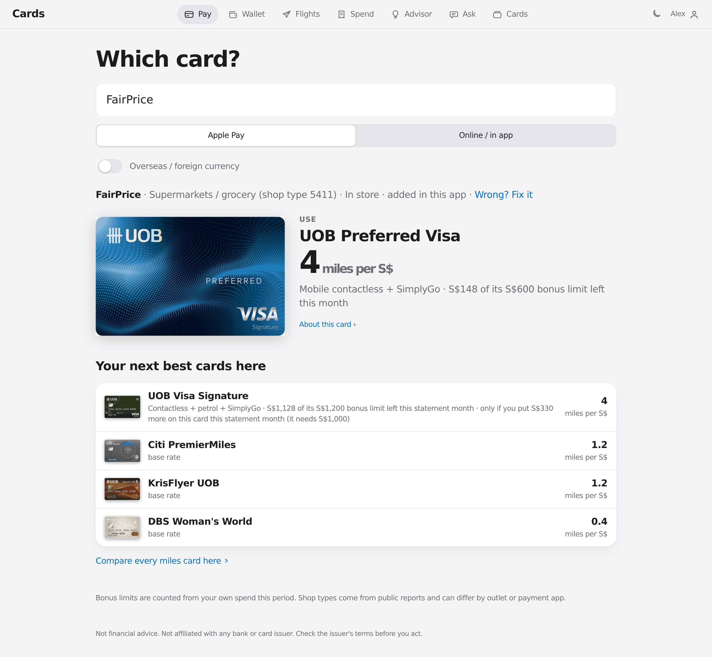
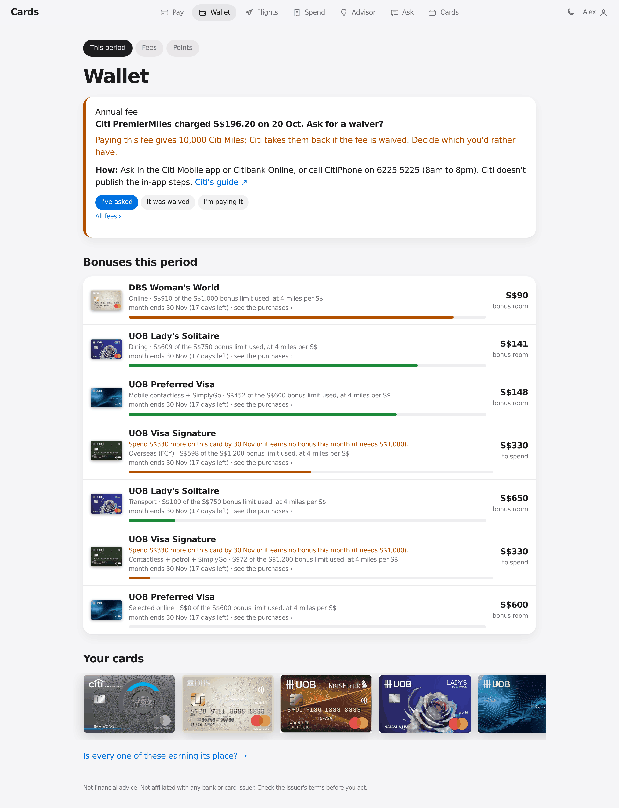
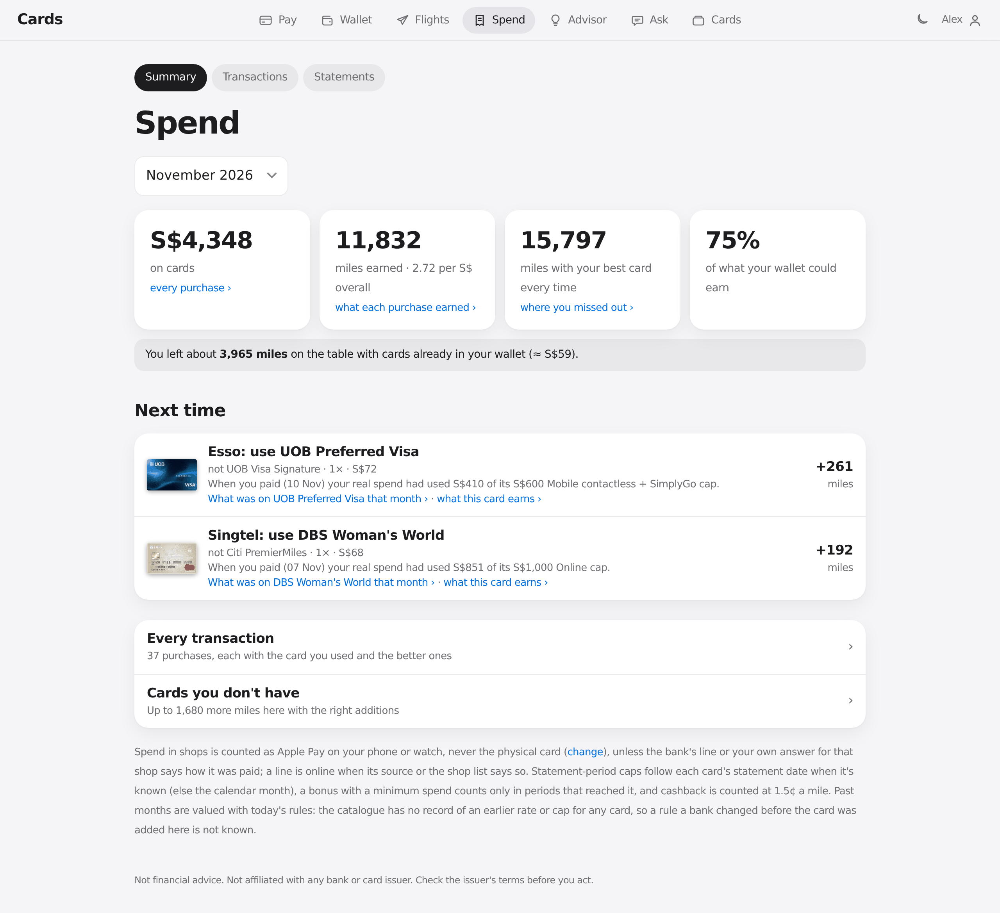
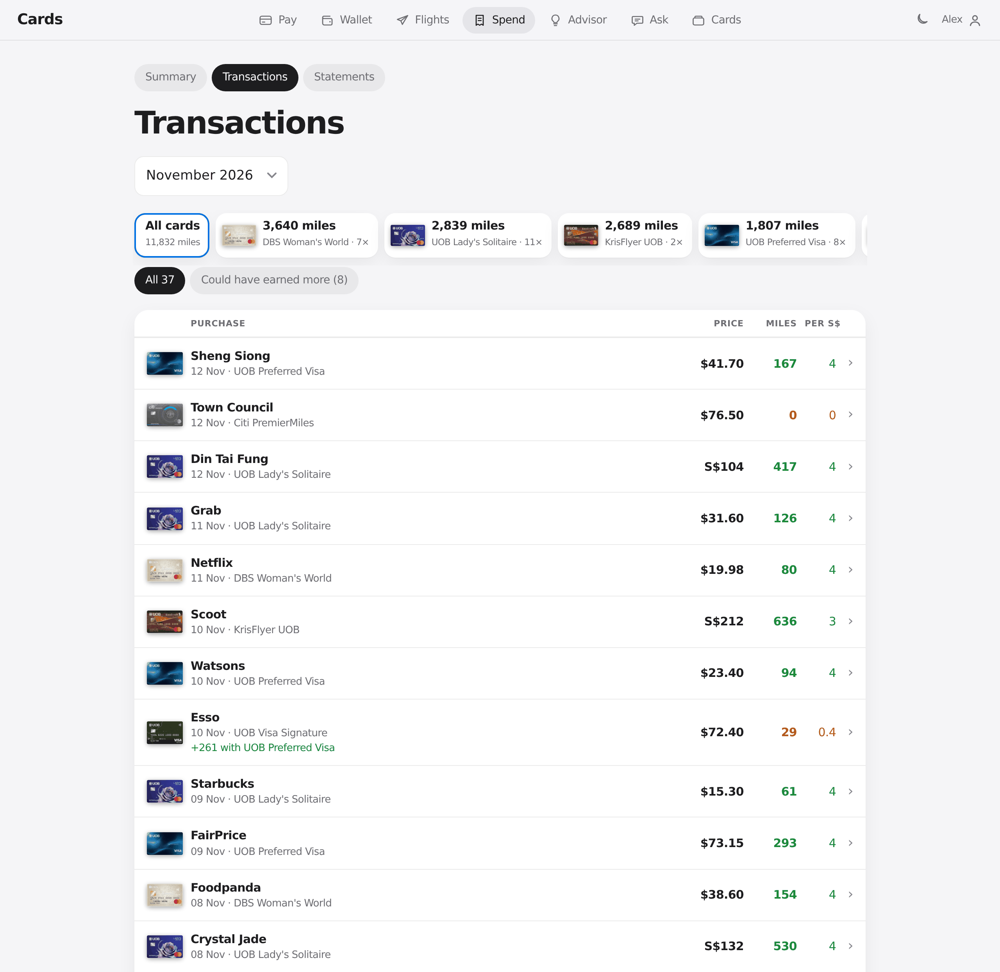
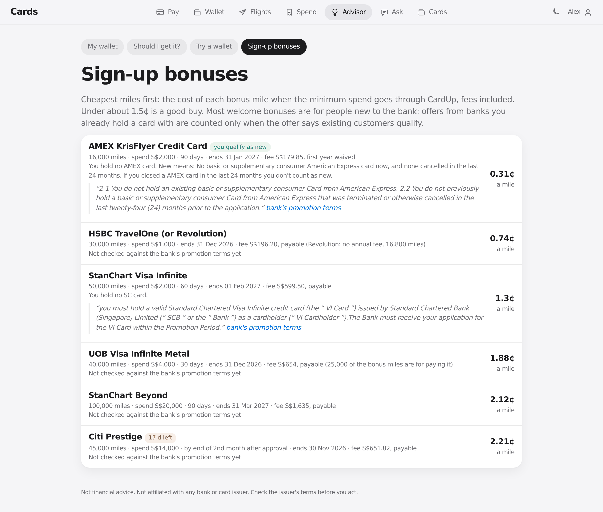
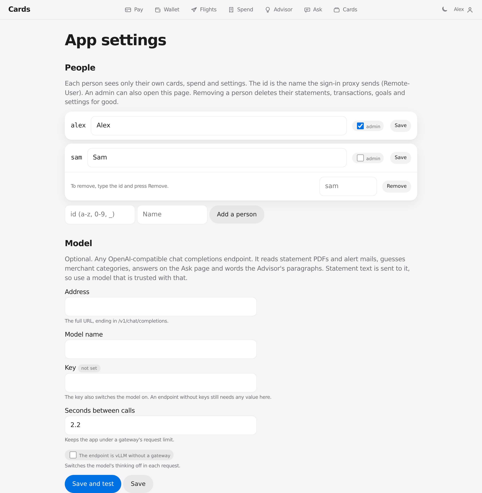
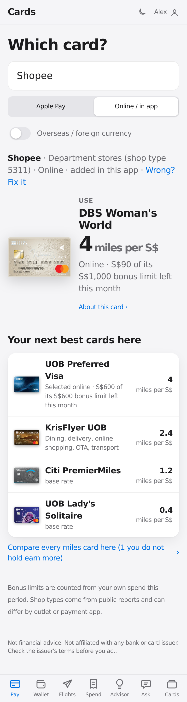

# SG Miles Advisor

Singapore miles credit cards pay their best rates only under conditions: a bonus category or a list of merchant
codes, a way of paying (phone, contactless, online), a monthly cap, and often a minimum spend. Someone who holds
several cards has to know, at the moment of paying, which card earns the most at this shop and whether its cap
still has room. The wrong card earns 0.4 miles per dollar where 4 were available.

SG Miles Advisor is a self-hosted web app that keeps track of this. It holds the rules of each card, reads the
person's own transactions, and answers three questions: which card to use for a purchase, what the wallet earned
this period, and which cards to keep, cancel or get.



The screenshots show invented demo data. More under [Screenshots](#screenshots).

Miles are counted in KrisFlyer miles per S$ (mpd). The rules cover bonus categories, MCC lists, caps, minimum spend,
rounding and exclusions.

Not financial advice. Not affiliated with any bank, card scheme, Singapore Airlines, The MileLion or Mainly Miles.

## Contents

- [What it does](#what-it-does)
- [Screenshots](#screenshots)
- [Quick start](#quick-start)
- [Configuration](#configuration)
- [Signing in](#signing-in)
- [Setting up mail](#setting-up-mail)
- [Personal data](#personal-data)
- [The model](#the-model)
- [Getting transactions in](#getting-transactions-in)
- [Data sources and their limits](#data-sources-and-their-limits)
- [Commands](#commands)
- [Development](#development)

## What it does

### Which card to pay with

Type a shop, or a merchant category code, and choose how the payment is made (phone, online, overseas). The Pay
page names the card to use now, its rate, and how much of its bonus cap is left this month. The next best cards
are listed underneath, each with the condition that applies, such as a minimum spend that has not been met yet.
The page is made for a phone at the till.

### Caps, minimum spends and fees

The Wallet page shows every bonus cap for the current period with the amount used and the room left, and every
minimum spend with the amount still to go and the date it must be reached by. Annual fees appear when they are
charged, with what paying the fee gives, how to ask the bank for a waiver, and a record of the answer. Points are
totalled per programme.

### What the spend earned

The Spend page shows what the month earned, what the same purchases would have earned on the best held card
every time, and the difference in miles. Each purchase is listed with its card, miles and rate, and with the
better card where there was one. The "Next time" list names the shops where a different card would have earned
more.

### Which cards to keep, cancel or get

The Advisor works out what each held card is worth in a year after its fee, from the person's own spend, and
gives a verdict: keep, ask for a waiver, or cancel. It lists cards worth adding, gives the sums for any one
card, and can try a whole wallet against the same spend. Sign-up bonuses are ranked by the cost of each bonus
mile, with who qualifies and the bank's own wording quoted.

### Where the miles can go

The Flights page shows where the miles on hand can go from Singapore, by cabin and party size, and tracks the
flights being saved for with the month each is reached.

### The card catalogue and the T&C check

Every card with its rules and MCC lists, and a side-by-side comparison of chosen cards. The T&C check compares
the stored rates, caps and MCC lists with documents fetched from the bank's own website and reports each
difference with the sentence quoted.

### How the figures are produced

The advice is arithmetic on the person's own transactions. Transactions come from one of three sources: card
accounts kept in [Wealthfolio](https://wealthfolio.app), bank alert mails and statement files, or a feed from
a script. See [Getting transactions in](#getting-transactions-in).

A model, when one is configured, only reads statements and words a paragraph from those sums. A paragraph that
contains a number the code did not produce is thrown away. See [The model](#the-model).

An installation can serve several people. Each person sees only their own cards, spend and settings.

### Pages

| Place | Pages |
|---|---|
| Pay | `/` |
| Wallet | `/wallet`, `/points`, `/fees` |
| Flights | `/flights`, `/goals` |
| Spend | `/spend`, `/spend/lines`, `/statements` |
| Advisor | `/advisor`, `/advisor/card`, `/simulate`, `/offers` |
| Cards | `/catalogue`, `/compare`, `/card/<id>`, `/mcc`, `/changes` |

The pages are server-rendered HTML and work without JavaScript.

## Screenshots

All of it is invented demo data: a made-up household, made-up card numbers and purchases. The cards and offers are the
public ones in the catalogue.

| | |
|---|---|
| [](docs/screenshots/wallet.png) | [](docs/screenshots/spend.png) |
| Wallet: bonus caps and minimum spends this period, and an annual fee to ask about. | Spend: what the month earned, what it could have earned, and what to do next time. |
| [](docs/screenshots/transactions.png) | [](docs/screenshots/offers.png) |
| Transactions: every purchase with the miles it earned, and a better card where there was one. | Sign-up bonuses: cheapest miles first, with who qualifies. |
| [](docs/screenshots/settings.png) | [](docs/screenshots/pay-phone.png) |
| App settings: the people who use the installation, and the optional model. | Pay on a phone, for use at the till. |

## Quick start

Needs Docker with the compose plugin.

```sh
git clone https://github.com/quinneydavid/sg-miles-advisor
cd sg-miles-advisor
cp .env.example .env        # then set PGPASSWORD in .env: it is empty and compose will not start without it
docker compose up -d
```

`PGPASSWORD` is the database password; `openssl rand -hex 16` makes one.

`docker compose up -d` uses the published image, `ghcr.io/quinneydavid/sg-miles-advisor:latest`
(`docker pull ghcr.io/quinneydavid/sg-miles-advisor:latest` fetches it by hand, and `docker compose pull` fetches a
newer one later). To build the image from the checkout instead, run `docker compose up -d --build`. The compose file
names both: its three app services share

```yaml
    image: ghcr.io/quinneydavid/sg-miles-advisor:latest
    build: .
```

and a compose file of your own that only runs the published image leaves out the `build:` line.

The app is then on http://127.0.0.1:8080. The first start creates the tables, loads a sample of twelve cards checked by hand
and makes one person, `me`, who needs no login.

Next steps:

1. Open Settings and tick the cards held.
2. Load the rest of the Singapore catalogue (fetches public pages):
   `docker compose run --rm app catalogue --only wiki`
3. Optional: connect a mailbox in Settings so bank mail is read by itself (see [Setting up mail](#setting-up-mail)).
4. Optional: set a model in App settings to read statement PDFs and alert mails (see [The model](#the-model)).

Nothing else goes in `.env`. Each person sets their own things on the Settings page; an admin sets the shared ones on
the App settings page (linked from Settings).

The compose file is for one person on a private machine. For more people, or any address others can reach, put a
signing-in proxy in front (see [Signing in](#signing-in)) and remove `CARDS_SINGLE_USER`. While `CARDS_SINGLE_USER` is
set, the app answers only when it is opened as `127.0.0.1`, `localhost` or `[::1]`; any other name it is opened under
goes in `CARDS_HOSTS`.

## Configuration

The environment holds only what the app needs before it can open its database and read it. `.env.example` lists these
with comments.

| Variable | Default | Meaning |
|---|---|---|
| `PGHOST`, `PGDATABASE`, `PGUSER`, `PGPASSWORD`, `PGSSLMODE` | `localhost`, `cards`, `cards`, none, `require` | Postgres. `DATABASE_URL` replaces all five. |
| `CARDS_KEY_FILE` or `CARDS_LOCAL_KEY` | empty | Local key that wraps the data keys. |
| `VAULT_ADDR`, `VAULT_TRANSIT_KEY`, `VAULT_AUTH_MOUNT`, `VAULT_ROLE`, `VAULT_TOKEN` | empty, `cards`, `kubernetes`, `cards`, empty | Vault Transit instead of a local key. |
| `CARDS_SINGLE_USER` | empty | One person id, no login. Private machines only. |
| `CARDS_HOSTS` | empty | With `CARDS_SINGLE_USER`: further names the app may be opened under, comma-separated. `127.0.0.1`, `localhost` and `[::1]` always work. |
| `CF_ACCESS_AUD`, `CARDS_PUBLIC_PORT` | empty, `8081` | Switches the public door on (Cloudflare Access audience tag). |
| `CARDS_INBOX_DIR` | `/inbox` | Where the drop folder is mounted. |

Everything else is set in the app and stored in the database. Passwords, keys and bot tokens are encrypted like the
rest of the personal data and are never shown again; the pages say "set" or "not set".

| Where | Who | What |
|---|---|---|
| Settings | each person | Cards held, how they pay, card last-4s and statement PDF passwords, the mailbox (with a connection test and a filter file for their banks), Wealthfolio, AwardWallet, typed points balances (Points page), a feeder token and a bot token. |
| App settings (`/admin`) | admins | People (add, rename, make admin, remove), the model (with a test), Telegram messages (with a test), match results and award seats (keys, each with a test), the catalogue run. |

The first person to open Settings while nobody is admin becomes the admin. Admins can make others admin. The last
admin cannot be removed or demoted.

A deployment that already has these values in its environment (`LLM_URL`, `TELEGRAM_BOT_TOKEN`, `CARDS_IMAP_<ID>_HOST`,
`CARDS_FEED_TOKEN_<ID>` and so on) keeps working: an environment value is used as long as nothing is stored in the app
for that setting. `python -m cards import-env` stores them all in the app in one go, after which they can be removed
from the environment.

## Signing in

The app has no login page of its own. It listens on two ports with two rules.

**Internal door, port 8080.** A reverse proxy signs people in (forward auth: Authelia, Authentik, Pocket ID with
Traefik and so on) and sets the header `Remote-User` to the person id and, if it can, `Remote-Email`. Only the proxy may
reach this port. Anyone who can reach it directly can send the header by hand.

`CARDS_SINGLE_USER` replaces the proxy: every request on this door is that person. Because nothing signs anyone in,
the app then checks the name it is asked for. A request whose `Host` is not `127.0.0.1`, `localhost` or `[::1]` (any
port) gets a 421, which stops a web page that points its own name at 127.0.0.1 (DNS rebinding) from reading the app.
If the app is opened under another name (a proxy in front, a container name, a LAN address), list those names in
`CARDS_HOSTS`, comma-separated, without the port. A bot or feeder that calls the app is checked the same way.
`/healthz` is not checked.

While the app has no people at all, the first person the proxy names is added and becomes the admin. Everyone after
that is added by an admin in App settings, with the id the proxy sends for them.

**Public door, port 8081.** For a Cloudflare tunnel with Cloudflare Access. It is off until `CF_ACCESS_AUD` is set.
The person is the email in the Access token; `Remote-User` is ignored. The tunnel must be set to refuse requests without
a valid Access token (`originRequest.access` in cloudflared), because the app checks the token's audience and expiry
but not its signature. Only cloudflared may reach this port. Each person signs in once on the internal door first: the
app then stores a keyed hash of their email and the public door recognises them.

A person whose id is not in the `people` table gets a 403 on either door.

## Personal data

Catalogue data (cards, rules, MCCs, offers) is public and stored in the clear. Everything personal is encrypted in the
app before it reaches Postgres: transactions, statement details, card last-4s, PDF passwords, the points wallet, fee
charges and written advice. A test (`tests/test_privacy_schema.py`) fails if a personal table gains a plain column.

- Field encryption is AES-256-GCM with the table, column and row bound in.
- The data keys are stored wrapped. A local key (`CARDS_KEY_FILE`) or a Vault Transit key wraps them.
- Secrets set in the app (mailbox app passwords, the model key, the Telegram bot token) are encrypted the same way and never shown again. API tokens are kept only as SHA-256 fingerprints.
- With no key source the personal pages say that encryption is unavailable. There is no plaintext fallback.
- A statement PDF is read in memory and then dropped. Its password is used once and not stored unless the person saves it in Settings for the mail ingest.

Back up the key file apart from the database. A database backup without the key cannot be read, and neither can the
live data once the key is lost.

## Setting up mail

Each person connects one mailbox on their Settings page, under Card mail. The app reads one folder of it over IMAP
and changes nothing there.

1. Choose the mail provider. The page then shows that provider's steps: where to make an app password and where its
   rules live. Gmail, iCloud Mail, Fastmail, Yahoo Mail and any other IMAP server can be connected. Outlook.com cannot
   (it no longer accepts app passwords for IMAP); the page explains how to forward bank mail to another mailbox.
2. Collect the bank mail in one folder. The page lists the sender domains of exactly the banks whose cards the person
   holds. For Gmail it offers a filter file (`mailFilters.xml`) with those rules, to import under Settings, Filters and
   Blocked Addresses; a tick box makes the rules skip the inbox. For other providers the same rules are shown as text
   to create by hand. A bank with no known sender is named instead of guessed.
3. Enter the user name and the app password and press "Save and test the connection". The test signs in, opens the
   folder read-only and says what failed if anything did: the server cannot be reached, the sign-in was refused, an
   app password is needed, or the folder does not exist (it then lists the folders that do).
4. Add each card's last 4 digits and any statement PDF password further down the page, so a mail can be matched to a
   card. Alerts for a card added later are kept aside and read again once its digits are saved (mail up to 45 days
   old), so a payment made before the card was set up still counts.

`ingest` then reads the folder: the compose file runs it every 15 minutes, elsewhere a scheduler runs
`python -m cards ingest`. The Settings page shows when mail was last read and what was counted. Reading alert mails
and statement PDFs needs a model.

Each bank only sends card mail that is switched on in its app or internet banking: transaction alerts by email and
e-statements by email.

## The model

Optional. Any OpenAI-compatible chat completions endpoint works (vLLM, Ollama, LiteLLM, a hosted API). An admin sets
the address, the model name and the key in App settings and can test them there. It is used for:

- reading statement PDFs and bank alert mails into transactions
- the Ask page (questions about the person's own figures)
- MCC guesses for shops with no known MCC
- a written paragraph on the Advisor pages
- checking candidate card pictures

Statement text and questions are sent to that endpoint, so it should be one the operator trusts with them. The app was
written for a model running on the same network.

Without a model the catalogue, Pay, the T&C check and the bot API work in full. Spend, Wallet and Advisor then need a
feeder for their transactions.

## Getting transactions in

One source per person, and one source per card. Whatever brings a line in, it goes through the same clean-up, so the
same text gives the same answer everywhere:

- the merchant text is tidied; the bank's own charges and payments to the card are dropped;
- a purchase abroad and its currency, and an online shop, are recognised from the text unless the source states them;
- the merchant category comes from the shop list, then from the model when one is set up.

The sources:

1. **Wealthfolio**: for people who keep their card accounts in [Wealthfolio](https://wealthfolio.app). See
   [Connecting Wealthfolio](#connecting-wealthfolio). Needs no model and no mailbox, and reads old purchases too.
2. **Mail and statement files**: for everyone else. `cards ingest` reads the mailbox the person connected (see
   [Setting up mail](#setting-up-mail)) and a drop folder `<CARDS_INBOX_DIR>/<person id>/`; a statement PDF can also be
   uploaded on `/statements`. Bank alert mails become transactions at once; the statement confirms them. Needs a model.
   A screenshot of the card's transaction list in the bank's app (PNG, JPEG or WebP) dropped in the same folder fills
   in what the alert mails missed. The model reads it twice and the two reads must agree on the amounts. Pending rows,
   rows not in S$ and rows older than 120 days are left out. The card comes from the last four digits on the
   screenshot, or from four digits in the file name (`UOB 1234.png`). A row that matches a line already held for that
   card (same amount within 3 days, or the same shop within 4% and 5 days, as when a foreign fee posts after the alert) is not added again, whether it came from an alert, a statement or an earlier
   screenshot, and an alert mail for a row a screenshot already added is skipped. The file is moved to `done/` with a
   `.txt` that says what became of each row, or to `failed/` with the reason. The model must be able to read images.
3. **Feed**: a script of the person's own posts transactions it already has.

Someone who uses only mail and statement files has nothing to choose. With more than one source in play, Settings shows
"Where each card's transactions come from": each held card with its source, and a way to move a card. "Automatic" means
a feeder that sends the card, else Wealthfolio when the card is matched to an account there, else mail and statement
files. Moving a card removes the lines the old source imported for it, and that source is no longer listened to for
the card. Statement files are never removed: they are hidden for a card and month that another source covers.

### How a purchase was paid

Some cards pay their bonus only for a phone, others for any tap or only online. For each line the app takes, in order:
what the source states, the person's saved answer for that shop, an online shop recognised from the text, the person's
usual way of paying (Settings), unknown. On `/spend/lines` every purchase whose source does not say has a "How was this
paid?" choice. The answer is remembered for that shop and applies to the open month and everything after. Settings
lists the shops remembered, with a way to forget one. The answers are stored encrypted.

### Statement closing day

Caps and minimum spends that run per statement need the day each card's statement closes. Settings has a field per
card (1 to 31; empty = the calendar month). It is filled in from a statement file when one is read. A typed day is
kept; after that a statement file's wins over a feeder's, which wins over an estimate from Wealthfolio notes.

### Connecting Wealthfolio

On the Settings page, section Wealthfolio:

1. In Wealthfolio, open Settings, then Agent access, and create a personal access token with the scopes
   `accounts:read` and `activities:read`. The app only reads; it never writes to Wealthfolio.
2. Enter the address Wealthfolio is opened at and the token, and press "Save and test". The test says plainly what is
   wrong: the address cannot be reached, the token was refused, or a scope is missing.
3. The accounts are then listed. Choose the card for each card account; the rest stay "not a card". A credit-card
   account whose name plainly names a held card is suggested.
4. "Save and import now" reads the transactions. With "Import on a schedule" ticked, every `ingest` run does it again
   (the compose file runs `ingest` every 15 minutes). `python -m cards wealthfolio --person <id>` runs it by hand.

What is imported: a `WITHDRAWAL` is a purchase, a `CREDIT` is a refund. Card payments (`TRANSFER_IN`), deposits and the
bank's own charges (interest, late and conversion fees) are left out; annual fees go to the fee tracker. The merchant
is the activity's note. A note may carry remarks, each after ` | `: the part before the first is the merchant. These
remarks are understood, as a convention any importer that fills Wealthfolio may follow:

| Remark | Meaning |
|---|---|
| starts with `alert` | The line is not confirmed by a statement yet. It is kept as an estimate and shown as "estimated, statement pending". |
| `... statement 2026-10` | The line was on that month's statement. This tells the card's statement period. |
| exactly a currency and an amount, `USD 20.00` | The statement printed this foreign amount: a purchase in that currency. |
| `alert, estimated from USD 20.00 ...` | An alert in a foreign currency whose S$ amount is an estimate until the statement. |

A currency named in a remark always wins over what the shop's text suggests; the text is the fallback. When an importer
replaces an estimate by the statement's line (a new activity), the estimate leaves and the statement line arrives in
the same run: nothing is counted twice, and an answer to "How was this paid?" stays, because it belongs to the shop.

Each run re-reads the last 62 days (a setting), so a line changed or deleted in Wealthfolio is changed or removed in
the app. A line older than those days is never removed for being old.

**Older purchases.** "Import history" on the same page reads everything older than those days once, from a date or
from the start. It works through one account at a time and writes a month at a time, in the background; the page shows
its progress, the final counts and the oldest purchase found. It can be run again: a line is the same line every time.
A month in which a card already has lines from a statement, an alert or a feeder is left alone, and the page lists
those months. A card given to another source is skipped. By hand:
`python -m cards wealthfolio --person <id> --since 2025-01-01` (or `--all`). With the history in, the Spend and Advisor
pages work from the longer record.

**Past months and today's rules.** A purchase is valued with the rule in force on its day where the catalogue recorded
that rule's change (it keeps each version with its dates from the day a card is added). It knows nothing of a rate or
cap a bank changed before that, so older months are otherwise valued with today's rules. The Spend pages say which
applies.

**A savings balance that boosts a card.** Where a held card pays more when a linked savings account holds enough, that
account (a cash account in Wealthfolio) can be named on the same page. Each import then works out its average
day-end balance for the month from the running balance Wealthfolio keeps on the account's activities. No further
scope is needed.

The token is stored encrypted and never shown again. Lines are encrypted like every other line. The app must be able
to reach Wealthfolio's address from where `web` and `ingest` run.

The Wealthfolio web version with Agent access (its `/mcp` endpoint) is needed. This project is independent and is not
affiliated with Wealthfolio, AwardWallet, seats.aero or football-data.org.

### Feed

```
POST /api/feed            (internal door)
Authorization: Bearer <the person's feeder token, made on their Settings page>

{"from": "2026-10-01", "to": "2026-11-12",
 "lines": [{"id": "stable-unique-id", "date": "2026-11-03", "card": "dbs_womens_world", "merchant": "SHOP NAME",
            "amount": 42.5, "fcy": false, "currency": "SGD", "online": true, "channel": "online", "mcc": "5311"}]}
```

Lines in the window are replaced by what arrives. Only `id`, `date`, `card`, `merchant` and `amount` are needed: what a
line does not state (`fcy`, `currency`, `online`, `channel`, `mcc`) is worked out by the shared clean-up. `channel` may
be `online`, `mobile`, `tap`, `insert` or `contactless` (a tap, device unknown). A line for a card the person gave to
another source is not taken. Optional keys: `statement_days`, `boosts`, `fees`, `wallet`, `awards` (see
`statements.feed`).

Nothing needs a feeder. Each of those optional keys has a source inside the app: closing days (typed, a statement
file, Wealthfolio notes), boost balances (a Wealthfolio account), annual fees (the person's own lines), the miles
wallet (below) and award prices (the chart). A feeder that sent nothing for three days no longer speaks for the miles
wallet, and Settings has "Stop listening to the feeder", which removes its token and everything only it supplied.

### Points and the miles wallet

The Points page works out what the person could have in KrisFlyer now. Per programme it takes the newer of the balance
printed on the latest statement and a balance typed on the page, and adds the points that programme's cards earned
since. The KrisFlyer account balance is typed, read from a statement, or kept current by AwardWallet: Settings takes an
AwardWallet Business API key and the id of one connected user, and the scheduled run asks a few times a day. Only the
key and that id go out. Points convert in whole transfer blocks; the leftover is shown.

### Match-day rates

A card whose rate depends on a football result names its fixtures in `cards/data/cards.json`
(`"fixtures": "football-data/<competition>/<team id>"`) and its rules match `{"match_day": "win"}` or `"draw"`. With a
free [football-data.org](https://www.football-data.org/) key in App settings, results are fetched a few times a day
and purchases on such days get the day's rate (the bonus day is the match's start date in the United Kingdom; a cap
may be per match day and a rule may allow a number of bonus days a month). A purchase on a day whose result is not in
yet is valued at the base rate and marked as possibly rising. Without a key these cards earn their base rate.

A bot reads with the person's bot token, also made on the Settings page: `GET /api/lookup?q=<shop or MCC>`, `/api/shop?q=`, `/api/caps`, `/api/wallet` (the miles wallet) and `/api/summary` (the daily summary as text).

## Data sources and their limits

| Data | Source | Kept current by |
|---|---|---|
| A sample of twelve cards checked by hand (`cards/data/cards.json`) | Each bank's own terms and exclusion lists, read on the dates written in the file | Hand |
| Other Singapore cards, T&C links, shop MCCs | [SG Miles Public MCC Wiki](https://sg-miles-public-wiki.pages.dev/) | `cards catalogue --only wiki` |
| Sign-up offers | [The MileLion](https://milelion.com/) sign-up bonus page; promotion terms from the banks (`offer-terms.json`) | `--only milelion`, hand |
| Transfer ratios | [Mainly Miles](https://mainlymiles.com/) transfer partner page | `--only mainlymiles` |
| KrisFlyer award chart (`krisflyer-chart.json`) and flight-goal prices | Singapore Airlines' published chart | Hand; `--only awards` loads the prices and reports when SIA no longer serves that chart |
| T&C check | PDFs and pages on the banks' own sites | `--only tc` |
| Card pictures | Image search through a SearXNG instance, stored in the database only | `--only images` |
| Dates with award seats (optional) | seats.aero partner API, with the admin's own key | `--only seats` |
| Match results (optional) | football-data.org, with the admin's own key | every scheduled run, at most every 3 hours; `--only matches` |
| KrisFlyer account balance (optional) | AwardWallet Business API, with the person's own key | every scheduled run, at most every 6 hours |

Limits:

- Banks change rules often. A rule here is right as of its check date at best. The T&C check reports differences; it never edits a rule.
- Cards outside the twelve carry headline rules from the wiki only (depth below `full`).
- MCCs for a shop are community data and can be wrong. The bank's MCC for the transaction decides.
- Offers expire. The `ends` date is shown and expired offers are dropped.
- Flight-goal prices are the chart's Saver and Advantage prices. Dates with seats are optional: with a
  [seats.aero](https://seats.aero/) partner key in App settings, the weekly run (`--only seats`) asks which dates from
  Singapore have award seats in the next year. seats.aero re-checks far dates rarely, so the dates are a hint.
- The data files contain short quotes from bank documents so a reader can check a rule against its source. Card
  pictures and names belong to their owners; no picture files are in this repository. The screenshots show card pictures as the app displays them.

The refresh is meant to run weekly. It makes one request per source page, pauses two seconds between requests to bank
sites, does not retry, records a refused request as blocked and leaves that site alone, and sends a User-Agent that
names the tool and this repository. The pause and the User-Agent can be changed in App settings. Maybank's site refuses automated requests, so its cards come from the wiki only.

Whoever runs the catalogue job is responsible for respecting the terms of the sites it reads (The MileLion, Mainly
Miles, the wiki, the banks) and should keep the schedule gentle: weekly is enough.

## Commands

```
python -m cards web                      both doors
python -m cards migrate                  create or update the tables
python -m cards seed                     tables + the sample of hand-checked cards
python -m cards catalogue [--only wiki|milelion|mainlymiles|images|links|tc|awards|seats|matches]
                                         [--dry-run] [--card ID] [--force]
python -m cards ingest [--every MIN]     mail, drop folder and Wealthfolio, for every person; --every keeps it running
python -m cards notify summary|alerts    daily message, new alerts
python -m cards wealthfolio [--person ID] [--since YYYY-MM-DD | --all]
                                         the Wealthfolio import alone: everyone who switched it on, or one person;
                                         --since / --all first read that person's older purchases (once)
python -m cards import-env               store settings found in the environment in the app (older deployments)
                                         --admin ID also makes that person an admin
```

With compose: `docker compose run --rm app <command>`.

## Development

```sh
python -m venv .venv && .venv/bin/pip install -r requirements.txt pytest
.venv/bin/pytest
```

Most tests need no database. Those that do run on a throwaway Postgres when `pgserver` is installed
(`pip install pgserver`) and are skipped otherwise. `pgserver` installs on Python 3.9 to 3.12 only, so on Python 3.13
the database tests are skipped. The app itself needs Python 3.12 or newer. `tests/test_look.py` checks the page scripts
with Node when it is installed. The web server is the standard library's; the only dependencies are
psycopg, cryptography, pypdf and Pillow.

The screenshots are retaken with `tools/demo/screenshots.py`. It starts a throwaway Postgres (`pgserver`) and the app
on 127.0.0.1, loads the invented household through the app's own pages (`tools/demo/seed.py`, which refuses anything
but a fresh single-user installation on this machine) and removes everything afterwards:

```sh
.venv/bin/pip install pgserver playwright && .venv/bin/playwright install chromium
.venv/bin/python tools/demo/screenshots.py      # writes docs/screenshots/*.png
```

With `--searx URL` (a SearXNG `/search` endpoint with JSON output, or `SEARX_URL`) it first runs the app's own picture
search, so the cards show real pictures instead of drawn ones; only card names are sent, and the address is not stored.

## Licence

MIT. See [LICENSE](LICENSE).
